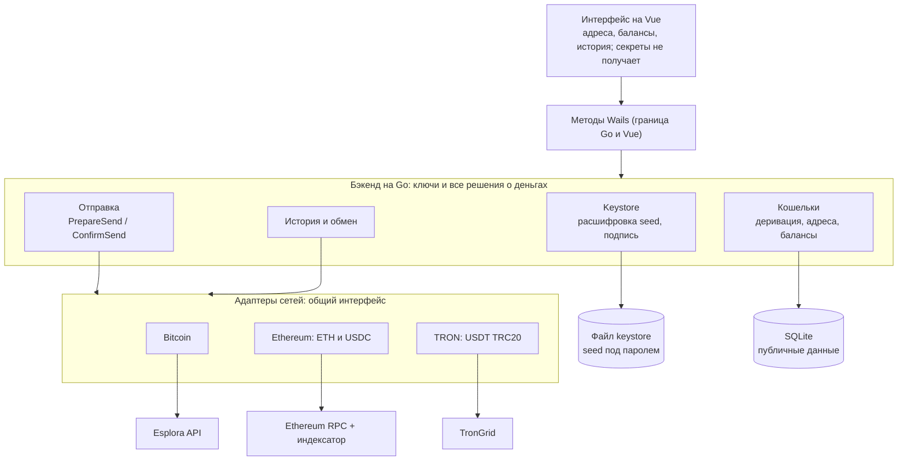
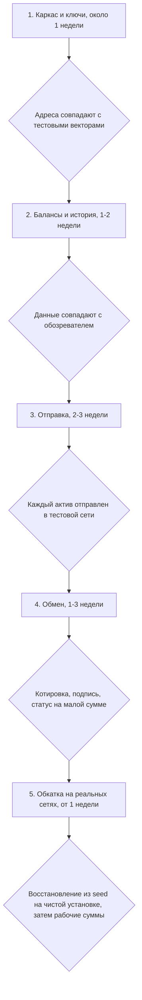

# ADR-001: Десктопный крипто-кошелёк (Wails + Go + Vue)

Nov 14, 2026 · @Vadim

## Статус, контекст и цели

Строим личный некастодиальный десктопный кошелёк для Windows: от 1 до 3 кошельков, в каждом по 4 актива (BTC, ETH, USDT в сети TRON, USDC). Статус решения: принято для версии 1 (16 ноября 2026); этап обмена отложен до отдельного ADR.

**Контекст.** Кошелёк нужен одному пользователю для себя. Ключи хранит сам пользователь, никакого сервера и чужих аккаунтов нет. Кошелька пока не существует, он создаётся с нуля.

**Цели первой версии:**

- создать кошелёк из новой seed-фразы или добавить кошелёк, импортировав существующую;
- видеть адреса и балансы всех четырёх активов в каждом кошельке;
- получать средства (показать адрес и QR-код);
- отправлять средства с понятным экраном подтверждения;
- видеть историю операций по каждому активу;
- обменивать активы (после отправки, отдельным этапом).

**Критерий успеха.** Пользователь проходит полный цикл «создал кошелёк, получил, отправил, посмотрел историю» на тестовых сетях без ручных действий вне программы. Приватные ключи и seed ни в какой момент не покидают Go-процесс.

## Область и не-цели

Первая версия закрывает базовый цикл кошелька на четырёх активах; всё, что превращает кошелёк в сервис или биржу, сознательно исключено.

**Входит в версию 1:**

- 1-3 кошелька, у каждого по 4 актива;
- создание и импорт seed-фразы (BIP39), шифрование паролем;
- балансы, получение, отправка, история;
- обмен: сначала внутри сети Ethereum (ETH и USDC), затем между сетями через обменник по API или THORChain.

**Не входит:**

- другие монеты и сети, NFT, DeFi-операции, стейкинг;
- несколько пользователей, облачная синхронизация, мобильное приложение;
- мультиподпись и аппаратные кошельки (возможное расширение, не в версии 1);
- кастодиальные функции: приём платежей для других людей, мониторинг чужих депозитов;
- собственные ноды: данные берём у внешних API-провайдеров.

**Ограничение по масштабу.** Число кошельков ограничено тремя в интерфейсе, но схема данных не должна на это опираться: добавить четвёртый кошелёк должно быть правкой одной константы, а не миграцией.

## Принятые решения

Все операции с ключами выполняются в Go, интерфейс на Vue видит только публичные данные; кошелёк определяется одной seed-фразой, из которой выводятся адреса всех четырёх активов.

| Вопрос | Решение | Основание |
| --- | --- | --- |
| Оболочка | Wails v2 (версию уточнить на старте; v3 была в альфе) | Один exe, WebView2 уже есть в Windows 10/11 |
| Бэкенд | Go | Зрелые библиотеки для BTC и ETH, ключи не попадают в JS |
| Фронтенд | Vue 3 + TypeScript | Выбор пользователя |
| Что такое «кошелёк» | Одна независимая seed-фраза BIP39 (12 или 24 слова) = один кошелёк = 4 актива | Позволяет импортировать существующий кошелёк и бэкапить каждый отдельно |
| Деривация BTC | BIP84, путь m/84'/0'/0'/..., адреса bc1q (native SegWit) | Самые низкие комиссии среди стандартных типов адресов |
| Деривация ETH и USDC | BIP44, путь m/44'/60'/0'/0/0, один адрес на оба актива | USDC в сети Ethereum это ERC-20, адрес общий с ETH |
| Деривация USDT | BIP44, путь m/44'/195'/0'/0/0, адрес TRON (начинается с T) | Стандартный путь для TRON |
| Адреса BTC | Новый адрес на каждое получение, сдача на отдельную цепочку, сканирование с gap limit 20 | Приватность и стандартное поведение HD-кошельков |
| Адреса ETH и TRON | Один адрес на кошелёк (index 0) | Модель счетов, новые адреса не нужны |
| Хранение публичных данных | SQLite через драйвер без CGO (modernc.org/sqlite) | Не требует C-компилятора на Windows |
| Хранение seed | Отдельный файл keystore, не в базе данных | Базу можно пересоздавать и логировать, keystore остаётся нетронутым |
| Шифрование keystore | Пароль, argon2id для ключа, AES-256-GCM для данных | Стандартные примитивы из golang.org/x/crypto и стандартной библиотеки |
| Источники данных | Внешние API за единым интерфейсом, своих нод нет | Низкая стоимость запуска, провайдера можно заменить |
| Отправка | Два шага: PrepareSend (расчёт, без ключа), затем ConfirmSend (подпись) | Пользователь всегда видит итог до подписи |
| Bitcoin RBF | Включён в v1 для P2WPKH; замена выполняется повышением комиссии | Решение владельца от 16.11.2026; `nSequence = 0xfffffffd` |
| Обмен | В v1 не реализуется; все пары и провайдер на холде | По TEAM-PROMPTS A9; возобновление только отдельным ADR и после выбора провайдера |

**Принято при согласовании:**

- USDC в версии 1 только в сети Ethereum (ERC-20).
- Один кошелёк = одна seed-фраза; несколько аккаунтов от одного seed не используются.
- Парольная фраза BIP39 поддерживается как необязательная для каждого кошелька и нигде не сохраняется.
- Резервная копия делается встроенной кнопкой (описана в разделе «Ключи и безопасность»).
- Обмен нужен для любых пар между четырьмя активами; способ описан в разделе «Функции».

Каждое решение можно пересмотреть отдельным ADR; изменение модели «кошелёк = seed» после появления пользовательских данных потребует миграции keystore.

## Модель данных

База хранит только публичные данные и кэш, а справочник из четырёх активов зашит в код: схема не зависит от числа кошельков (1-3) и от того, что в каждом ровно 4 актива.

| Сущность | Ключевые поля | Примечание |
| --- | --- | --- |
| wallet | id, name, created\_at, keystore\_id, btc\_xpub, sort\_order | Один кошелёк = одна seed-фраза. Seed здесь не хранится, только ссылка на запись keystore |
| address | id, wallet\_id, network, address, path, chain (receive или change), idx, used | BTC: много адресов. ETH и TRON: по одному на кошелёк |
| balance | wallet\_id, asset, amount, updated\_at | Кэш; источник истины всегда сеть |
| utxo | txid, vout, address\_id, amount, confirmations, spent | Только BTC, нужны для расчёта и подписи отправки |
| transaction | id, wallet\_id, asset, txid, direction (in, out, self), amount, fee, fee\_asset, status, block\_height, ts, counterparty | История, приведённая к одному виду для всех сетей |
| swap | id, wallet\_id, from\_asset, to\_asset, from\_amount, expected\_to\_amount, provider, status, external\_id, deposit\_address, created\_at | Появляется на этапе обмена |
| setting | key, value | Провайдеры API, язык, лимиты |

**Справочник активов (в коде, не в БД):**

| Актив | Сеть | Тип | Знаков после запятой |
| --- | --- | --- | --- |
| BTC | Bitcoin | основная монета | 8 (сатоши) |
| ETH | Ethereum | основная монета | 18 (wei) |
| USDC | Ethereum | токен ERC-20, комиссия в ETH | 6 |
| USDT | TRON | токен TRC20, комиссия в TRX | 6 |

**Правила хранения сумм.** Суммы хранятся целыми числами в минимальных единицах, в БД как текст (ETH в wei не помещается в int64), в Go как big.Int. Дробные числа и float для денег не используются нигде. Перевод в человекочитаемый вид выполняется только на границе интерфейса.

**Комиссия в другом активе.** Для USDC нужен ETH на оплату газа, для USDT нужен TRX. Поэтому интерфейс показывает баланс комиссионной монеты рядом с токеном и предупреждает, если её не хватает. TRX не входит в заявленные 4 актива, но его баланс нужно показывать и уметь принимать, иначе USDT отправить не получится.

## Архитектура

Бэкенд на Go состоит из четырёх модулей над тремя адаптерами сетей, а интерфейс обращается к нему только через методы Wails.

Ключ не пересекает границу Go и Vue: Keystore расшифровывает seed и подписывает, адаптеры только собирают транзакции и говорят с провайдерами, интерфейс получает готовые описания для показа.

**Что умеет каждый адаптер сети (общий интерфейс в Go):**

- получать адреса и проверять чужой адрес по правилам своей сети;
- возвращать баланс актива;
- возвращать историю в общем формате;
- оценивать комиссию;
- собирать неподписанную транзакцию и описание для экрана подтверждения;
- отправлять подписанную транзакцию и сообщать её статус.

Подпись в интерфейс сети не входит: её выполняет только Keystore, получив неподписанную транзакцию и пароль.

**Методы Wails (ориентировочный список):** ListWallets, CreateWallet, ImportWallet, RenameWallet, DeleteWallet, GetBalances, GetReceiveAddress, GetHistory, PrepareSend, ConfirmSend; на этапе обмена добавляются GetSwapQuote и StartSwap.

## Ключи и безопасность

Приватный ключ существует в памяти только на время подписи и только в Go-процессе; пароль нигде не хранится, а seed без пароля на диске не читается.

**Жизненный цикл ключа**

1. Создание: seed генерируется из системного криптографического генератора (crypto/rand), показывается один раз, пользователь подтверждает, что записал его (вводит несколько слов из фразы по запросу программы).
2. Хранение: seed шифруется ключом из пароля (argon2id, параметры сохраняются в самом файле, чтобы их можно было усилить позже) и записывается в keystore-файл, а в базе данных остаётся только публичный расширенный ключ BTC (xpub).
3. Просмотр: балансы и адреса считаются по публичным данным, для расчёта пароль не нужен (экран блокировки лишь скрывает данные от постороннего). xpub не даёт доступа к средствам, но раскрывает все адреса кошелька, поэтому база данных считается приватным файлом.
4. Отправка: пароль запрашивается при каждом подтверждении. Go расшифровывает seed, выводит нужный ключ, подписывает транзакцию, затем обнуляет буферы.
5. Блокировка: интерфейс блокируется по таймауту бездействия (значение настраивается).

**Парольная фраза BIP39 («25-е слово»).** Для каждого кошелька она необязательна; если она задана, все ключи выводятся из seed вместе с ней, поэтому тот же seed с другой фразой даёт другие адреса, а опечатка не вызывает ошибку, а открывает другой, пустой кошелёк. Правила:

- фраза нигде не сохраняется: ни в keystore, ни в базе, ни в резервной копии, иначе она не добавляла бы защиты сверх пароля; пользователь вводит её при создании и при каждой отправке;
- при создании фраза вводится дважды, при импорте после ввода показываются первые адреса для сверки;
- перед подписью программа проверяет, что выведенный из seed и фразы адрес совпадает с адресом кошелька в базе, при несовпадении подпись отменяется;
- программа предупреждает, что фразу нужно записать отдельно от seed, а без неё восстановление невозможно.

**Резервная копия (кнопка в настройках).** Одна кнопка собирает архив из двух частей и предлагает выбрать, куда его сохранить:

- keystore в том виде, как он лежит на диске (зашифрован паролем, программа его не расшифровывает);
- согласованный снимок базы SQLite, который делается средствами самой SQLite при открытом приложении, плюс контрольная сумма архива.

Копия не содержит парольную фразу BIP39 и бесполезна без пароля. Она не заменяет запись seed-фразы: деньги восстанавливаются только из seed (и фразы, если она была). Зато копия возвращает то, чего нет в сети: имена кошельков и записи об обменах. Восстановление: кнопка «Восстановить из копии» на первом экране проверяет контрольную сумму и просит пароль.

**Модель угроз**

| Угроза | Мера |
| --- | --- |
| Кража файла keystore | Без пароля файл бесполезен; argon2id замедляет перебор, параметры подбираются под компьютер пользователя |
| Вредоносный скрипт во фронтенде | Методы Wails не принимают и не возвращают seed, ключи и пароль после разблокировки; без внешних скриптов и CDN, строгий CSP |
| Подмена адреса получателя (в том числе через буфер обмена) | Адрес показывается целиком на экране подтверждения, проверяются формат и контрольная сумма (bech32, EIP-55, base58check), особое предупреждение при первой отправке на новый адрес |
| Недобросовестный или взломанный API-провайдер | Транзакции собираются и подписываются локально; для TRON поля транзакции проверяются перед подписью, а не берутся из ответа сервера на веру |
| Отправка не в той сети (например, USDT не в TRC20) | Актив жёстко определяет сеть, адрес проверяется валидатором именно этой сети, сеть подписана на каждом экране |
| Утечка через логи | Seed, ключи и пароль не попадают в логи; секреты хранятся в отдельных типах без строкового представления |
| Остатки ключей в памяти | Секреты хранятся как срезы байтов и затираются; сборщик мусора Go полной гарантии не даёт, этот остаточный риск принимается |
| Потеря компьютера или забытый пароль | Восстановление только из seed-фразы, поэтому её резервная копия обязательна и проверяется при создании |
| Вредоносное ПО на компьютере (кейлоггер, подмена экрана) | Вне модели программы; при росте сумм рассмотреть аппаратный кошелёк |

## Сети и источники данных

Четыре актива живут в трёх разных сетях с разными моделями комиссий; каждая сеть закрывается своим адаптером за общим интерфейсом, а данные приходят от внешних провайдеров, которых можно заменить.

| Сеть | Что нужно от провайдера | Кандидаты (проверить условия и лимиты на старте) | Как считается комиссия |
| --- | --- | --- | --- |
| Bitcoin | Список UTXO и транзакций по адресу, оценка ставки, отправка raw-транзакции | Esplora API: mempool.space или Blockstream | Ставка в сатоши за виртуальный байт, размер считается по числу входов и выходов; выбор UTXO и сдача на нашей стороне, RBF включён для возможности ускорить транзакцию |
| Ethereum (ETH и USDC) | JSON-RPC: баланс, nonce, оценка газа, отправка; история токенных переводов | RPC-провайдер (Alchemy, Infura или аналог) плюс индексатор истории (Etherscan API) | EIP-1559: maxFeePerGas и maxPriorityFeePerGas; для USDC газ оценивается вызовом контракта и платится в ETH |
| TRON (USDT TRC20) | Баланс, ресурсы аккаунта, оценка energy, отправка, история TRC20 | TronGrid | Energy и bandwidth; если ресурсов не хватает, сжигается TRX. Всегда задаётся fee\_limit, а оценка energy делается перед каждой отправкой, потому что стоимость зависит от состояния получателя |

**Правила работы с провайдерами**

- Все обращения идут через интерфейс провайдера с таймаутами, повторами и возможностью задать резервный адрес. Ключи API хранятся в настройках бэкенда и не передаются во фронтенд.
- Данные провайдера не считаются доверенными для подписи: сумма, получатель и комиссия в транзакции проверяются локально перед подписью.
- Баланс BTC показывается раздельно: подтверждённый и ожидающий. Для остальных сетей статус транзакции отображается как «в ожидании», «подтверждено», «ошибка».
- Профиль сети (основная или тестовая) выбирается один раз для всего приложения, а не для кошелька, чтобы нельзя было перепутать; тестовый режим выделяется цветом на каждом экране.
- Адреса контрактов USDC и USDT берутся только из официальной документации эмитентов (Circle и Tether), записываются в конфигурацию и защищены тестом, чтобы случайная правка не подменила токен.

## Функции

Пять функций, от простых к сложным: добавление кошелька, получение, отправка, история, обмен; самые рискованные места это отправка в сети TRON и подпись транзакций, пришедших от стороннего сервиса при обмене.

**Добавление кошелька (от 1 до 3)**

- Создать новый: seed из 12 слов по умолчанию (можно 24), экран с фразой, затем проверка нескольких слов, затем пароль, необязательная парольная фраза BIP39 и запись seed в keystore. Парольная фраза нигде не сохраняется (подробности в разделе «Ключи и безопасность»).
- Импортировать: ввод фразы с подсказкой слов и проверкой контрольной суммы BIP39. Если у кошелька была парольная фраза, она вводится отдельно; после ввода программа показывает первые адреса для сверки. Адреса BTC зависят от схемы деривации (здесь BIP84), поэтому у кошелька, созданного другой программой по другой схеме, адреса и баланс BTC могут не совпасть; программа предупреждает об этом при импорте.
- Переименовать кошелёк можно в любой момент. Удалить кошелёк можно только после ввода пароля и имени кошелька, с предупреждением, что без записанной seed-фразы средства будут потеряны.
- Четвёртый кошелёк интерфейс не создаёт (ограничение в одной константе).

**Получение**

- Для каждого актива показываются адрес и QR-код. Для BTC это следующий неиспользованный адрес.
- Рядом с адресом USDC стоит пометка «только ERC-20 в сети Ethereum», рядом с адресом USDT «только TRC20 в сети TRON»: это основная защита от перевода не в ту сеть.

**Отправка**

1. Пользователь выбирает кошелёк и актив, вводит адрес и сумму. Адрес проверяется по формату и контрольной сумме именно для сети актива.
2. PrepareSend считает комиссию и собирает транзакцию, не используя ключ. Предупреждения: не хватает комиссионной монеты (ETH для USDC, TRX для USDT), сумма ниже порога пыли (BTC), адрес новый или совпадает с собственным.
3. Экран подтверждения показывает сеть, актив, получателя целиком, сумму, комиссию в её монете и итог.
4. ConfirmSend запрашивает пароль, подписывает, отправляет транзакцию и сразу записывает её в историю как ожидающую. Подписанная транзакция сохраняется до подтверждения приёма сетью, чтобы повторное нажатие не создало дубль.
5. RBF для Bitcoin включён в версию 1: исходящие P2WPKH-транзакции используют заменяемый sequence и могут ускоряться повторной отправкой с повышенной комиссией. Это решение владельца от 16.11.2026 отменяет прежнее отложенное включение RBF. Замена Ethereum-транзакций по nonce в первую версию не входит.

**История**

- Все сети приводятся к одной записи: актив, направление, сумма, комиссия, статус, время, контрагент, ссылка на обозреватель.
- BTC: транзакции собираются по всем адресам кошелька, направление определяется по входам и выходам. ETH: обычные переводы и переводы ERC-20 запрашиваются отдельно. TRON: переводы TRC20 из TronGrid.
- История кэшируется в SQLite, обновляется при запуске и по таймеру, фильтруется по кошельку и активу.

**Обмен (отдельный этап)**

- Нужны любые направления между четырьмя активами (BTC, ETH, USDC, USDT), то есть шесть пар. Все четыре актива торгуются на THORChain в нативном виде: Bitcoin, Ethereum (ETH и USDC), TRON (USDT) ([THORChain](https://thorchain.org)). Для ChangeNOW в описании API заявлены сотни пар без учётной записи ([описание API](https://jentic.com/apis/changenow.io/changenow)); наличие конкретных пар и сетей проверяется запросом списка пар перед началом этапа. Данные на 14 ноября 2026.
- ETH и USDC: обмен внутри Ethereum, своп через агрегатор. Шаги: котировка, для USDC ограниченное разрешение (approve на нужную сумму, не бесконечное), проверка проскальзывания, подпись. Транзакция, полученная от агрегатора, подписывается только если контракт назначения совпадает с адресом роутера из официальной документации: подпись чужой транзакции это главный вектор атаки на этом шаге.
- Остальные пять пар (между сетями): два возможных пути, окончательный выбор открыт.
  1. Обменник по API (например, ChangeNOW). Программа запрашивает пары, котировку и допустимый диапазон суммы, создаёт обмен со своим адресом получения, получает депозитный адрес; пользователь подтверждает обычную отправку на него, статус опрашивается по номеру обмена ([описание API](https://jentic.com/apis/changenow.io/changenow)). Нужен партнёрский ключ API. Плюсы: обмен сводится к обычной отправке, интеграция простая. Минусы: на время обмена средства у сервиса, спред, лимиты суммы.
  2. THORChain напрямую: нативные активы без обёрток и мостов, без учётной записи; USDT в TRC20 поддерживается ([THORChain: интеграция TRON](https://blog.thorchain.org/tron-integration-complete-native-trx-usdt-swaps-live-on-thorchain)). Комиссии: газ сети отправки, а комиссия пула и газ сети получения вычитаются из результата. Плюсы: нет посредника, который держит средства. Минусы: интеграция сложнее: перевод идёт на адрес хранилища сети со служебной пометкой (memo), адрес нужно брать из API перед каждой отправкой, ошибка стоит денег; детали сверить с dev.thorchain.org до начала этапа.
- Рекомендация: в версии 1 взять обменник по API, потому что обмен сводится к отправке, которую кошелёк уже умеет; THORChain добавить второй реализацией позже за тем же интерфейсом.
- Правила для обоих путей: свой адрес получения и адрес возврата передаются явно и сверяются в ответе; сумма проверяется по допустимому диапазону пары; курс считается предварительным, и экран подтверждения показывает ожидаемый результат с этой оговоркой.
- Не проверено: доступность выбранного сервиса в стране пользователя и требования к проверке личности. Сам протокол THORChain учётной записи не требует, но сторонние интерфейсы могут иметь свои требования, а условия обменника задаются его правилами. Проверить по условиям использования до начала этапа; выбор провайдера оформляется отдельным ADR.

## Интерфейс

Восемь экранов на Vue; фронтенд только показывает данные и собирает ввод, а любое решение, связанное с деньгами, принимает Go.

| Экран | Что показывает | Действия |
| --- | --- | --- |
| Блокировка | Поле пароля, показывается при запуске и после таймаута бездействия | Разблокировать (пароль проверяется расшифровкой keystore, результат не сохраняется) |
| Главная | От 1 до 3 карточек кошельков, в каждой 4 актива с балансом и временем последнего обновления | Открыть кошелёк, добавить кошелёк |
| Добавить кошелёк | Мастер: создать (показ фразы, проверка слов, пароль) или импортировать | Создать, импортировать |
| Кошелёк | Четыре актива, балансы, баланс комиссионной монеты (ETH, TRX) рядом с токеном | Получить, отправить, обменять, открыть историю |
| Получить | Адрес, QR-код, пометка сети | Копировать адрес |
| Отправить | Три шага: ввод, проверка (комиссия, предупреждения), пароль (и парольная фраза BIP39, если задана) и подтверждение | Назад, подтвердить |
| История | Единый список по кошельку или активу, статусы, ссылка на обозреватель | Фильтр, обновить, открыть в браузере |
| Настройки | Профиль сети, провайдеры API, таймаут блокировки | Сменить пароль, показать seed (по паролю), создать резервную копию, восстановить из копии, переименовать или удалить кошелёк |

**Правила интерфейса**

- Сеть актива подписана на каждом экране, где есть адрес или сумма; тестовый профиль выделен цветом.
- Балансы и история каждого актива загружаются независимо: сбой одного провайдера не блокирует остальные, на карточке видно «обновлено N минут назад» и ошибку.
- Суммы вводятся строкой и разбираются в Go в целые минимальные единицы; JavaScript-числа с плавающей точкой для денег не используются.
- Оценка в фиатной валюте и курсы в версию 1 не входят.

## План разработки

Разработка идёт пятью этапами, и каждый заканчивается проверкой; рабочие суммы доверяются программе только после последней.

Каждый ромб это проверка, без которой следующий этап не начинается. Сроки грубые и пересматриваются после первого этапа.

**Тестовые среды.** Bitcoin: testnet или signet. Ethereum: Sepolia. TRON: Nile. Тестовые монеты и токены берутся из кранов этих сетей, их доступность проверяется на старте. Обменники, как правило, не работают на тестовых сетях, поэтому обмен проверяется малой суммой в основной сети.

**Что нужно на Windows до старта:** Go, Node.js и Wails CLI; готовность окружения проверяется командой wails doctor. WebView2 уже входит в Windows 10 и 11.

## Риски, альтернативы и открытые вопросы

Главный риск проекта это ошибка в коде, которая стоит денег без возможности вернуть их, поэтому все остальные решения подчинены тому, чтобы такую ошибку поймать до реальных сумм.

**Риски**

| Риск | Мера |
| --- | --- |
| Ошибка в подписи, комиссии или адресе: потеря средств | Тестовые сети на каждом этапе, известные тестовые векторы, экран подтверждения, реальные сети только с малыми суммами |
| Слабая поддержка TRON в экосистеме Go | Транзакции TRC20 собираются и проверяются локально, минимум внешних зависимостей |
| Атака через зависимости (supply chain) | Мало зависимостей, версии зафиксированы в go.sum, проверка go mod verify, обновления вручную |
| Зависимость от внешних API (лимиты, смена условий) | Единый интерфейс провайдера, резервный адрес, кэш |
| Сложность BTC: UTXO, сдача, комиссия | Тесты выбора UTXO и расчёта размера транзакции на известных примерах, консервативная оценка комиссии |
| Потеря seed-фразы | Обязательная проверка записи при создании кошелька; других способов восстановления нет |
| Обменник недоступен, ошибается или задерживает выплату | Маленькие суммы при первых обменах, лимиты, отслеживание статуса, обмен вынесен в отдельный этап |

**Рассмотренные альтернативы**

- Electron и TypeScript: быстрее старт, но подпись происходила бы в JavaScript-процессе рядом с интерфейсом; отклонено в пользу границы Go и Vue.
- Tauri и Rust: лёгкая оболочка и сильная типизация, но больше нового кода и инструментов для автора; отклонено.
- Готовые отдельные кошельки по каждой сети: вообще не нужно писать код, но четыре программы, нет общей истории и обмена; цель проекта именно в едином инструменте.

**Открытые вопросы**

- [x] Выбор обменника / THORChain — отложен: весь этап обмена, включая ETH↔USDC, не входит в v1. Возобновление только после выбора провайдера и отдельного ADR.
- [x] Доступность обменного сервиса и требования KYC — проверяются после возобновления этапа обмена.
- [x] Оценка в фиатной валюте — не входит в v1; решение о ней принимается отдельным ADR.
- [x] Wails v2/v3 — выбран Wails v2.17.0; v3 остаётся за пределами v1.
- [ ] Условия бесплатных тарифов и лимиты провайдеров — перепроверять перед релизом и фиксировать в README соответствующего адаптера.

**Зафиксированные решения владельца и команды:** USDC только в Ethereum; один кошелёк = одна seed-фраза; парольная фраза BIP39 необязательна и не сохраняется; резервная копия встроенная; Bitcoin RBF включён в v1; обмен полностью на холде.
